# Maven-Toys-Challenge-Dashboard
Using Microsoft Excel to analyze sales performance, profitability, and historical trends to support data-driven retail expansion decisions.
## Introduction
Maven Toys plans to expand its business by opening new stores. To support this decision, an analysis of sales performance, profitability, historical trends, and the contribution of each location to sales revenue across different cities is required to identify cities and specific locations with strong potential to support business expansion.
This project is part of the Maven Toys Challenge, in which the role of a Business Intelligence Consultant is undertaken to analyze data and develop data-driven recommendations for business expansion.
The analysis is conducted using Microsoft Excel, leveraging its data processing, data modeling, analytical, and interactive visualization features to develop a single-page dashboard.
## Project Goals
The primary objective of this project is to identify cities and locations with strong potential for new store expansion based on several key business indicators :
  1. **Sales Performance** : Comparing sales revenue across cities to identify those with the strongest sales performance.
  3. **Profitability** : Evaluating the profit contribution of each city to identify those with the highest profitability.
  4. **Historical Trend** : Understanding the consistency and changes in bussiness performance over time to assess growth potential.
  5. **Location Revenue Contribution** : Comparing revenue across locations within selected cities to identify the most promising locations for new store openings.

The analysis results are presented in a single-page dashboard to support the evaluation of expansion candidates and data-driven business decision-making.
## Data Sourcing
This data was gotten from the Maven Analytics playground as part of the Maven Toys challenge. Here is a **[link to the dataset](https://mavenanalytics.io/challenges/maven-toys-challenge)** for your reference.

Disclaimer: The data in this dataset is fictitious and was made for the purpose of learning and practice.
## Tools and Features Used
The following Microsoft excel features were used in this analysis :

1. Power Query : Imports, cleans, transforms, and prepares data for analysis.
2. Power Pivot : Builds data models and manages relationships between tables to enable cross-table analysis.
3. DAX (Data Analysis Expressions) : Creates measures to calculate business metrics used in the analysis and dashboard.
4. PivotTable : Summarizes and calculates business performance metrics, KPIs, and historical trends by city, location, category, and time period before visualization.
5. PivotChart : Visualizes performance comparisons and historical trends.
6. Slicer : Provides interactive filters to explore data in the dashboard.
## Analysis Workflow

### Data Prepation
Data is prepared using Power Query by checking data structures and making necessary   adjustments to ensure readiness for analysis.
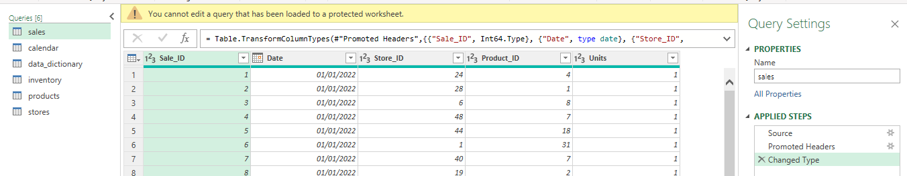
### Data Modeling and Calculations
Power Pivot is used to build data models and table relationships, while DAX creates measures to calculate key business metrics, such as revenue and profit.
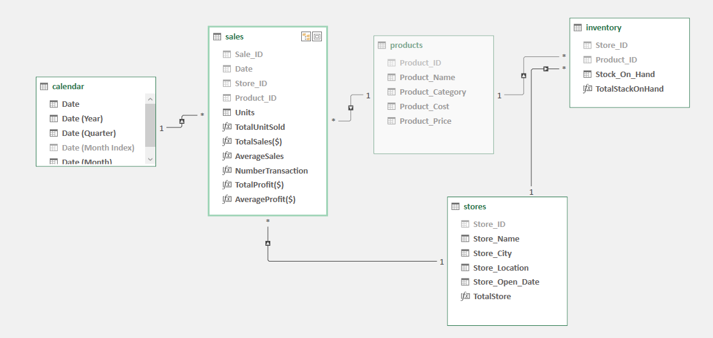
### City Performance Analysis
Cities are ranked by revenue and profit. Cities that rank in the top five for both metrics are selected as potential expansion candidates.
<table>
  <tr>
    <th>Top 5 City By Revenue</th>
    <th>Top 5 City By Profit</th>
  </tr>
  <tr>
    <td align="center">
      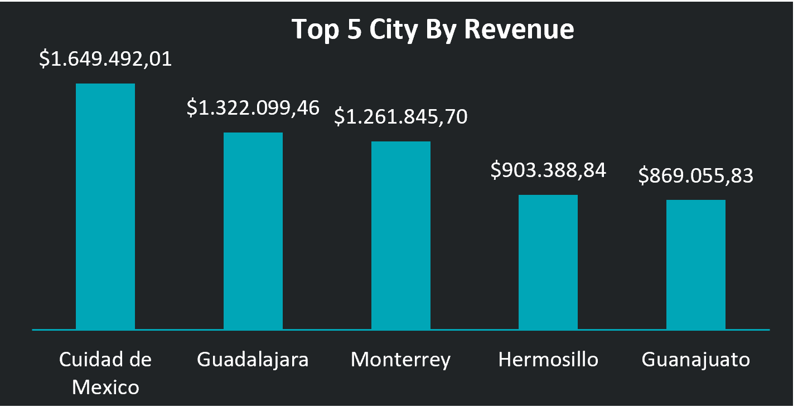
    </td>
    <td align="center">
      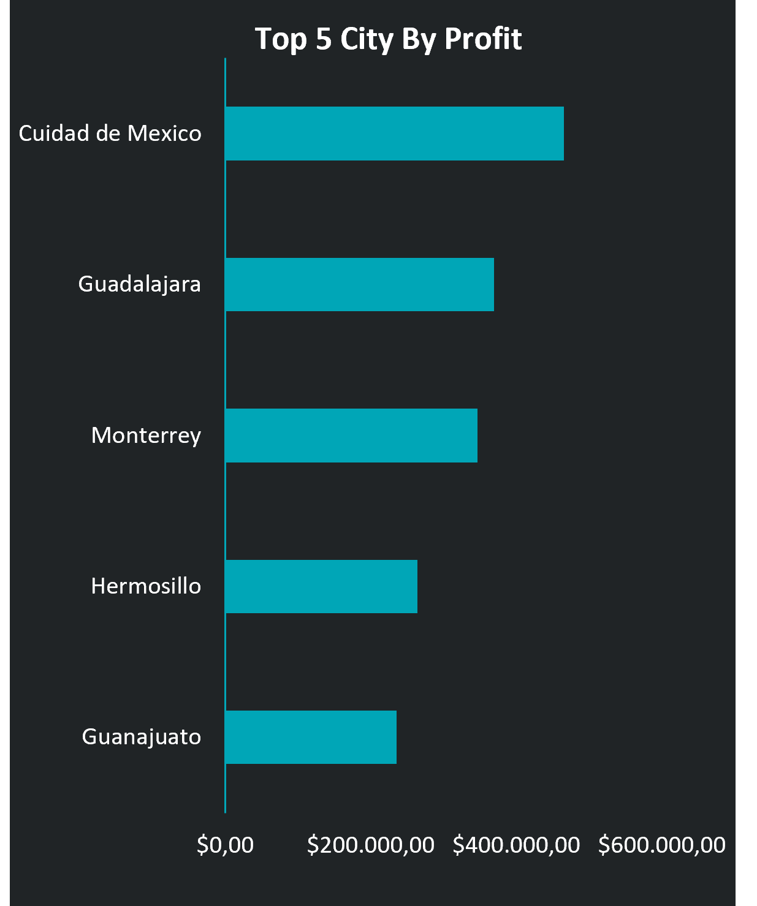
    </td>
  </tr>
</table>

### Historical Trend Analysis
Revenue and profit trends are analyzed over time to identify cities with stable or growing performance and distinguish them from those experiencing declines.

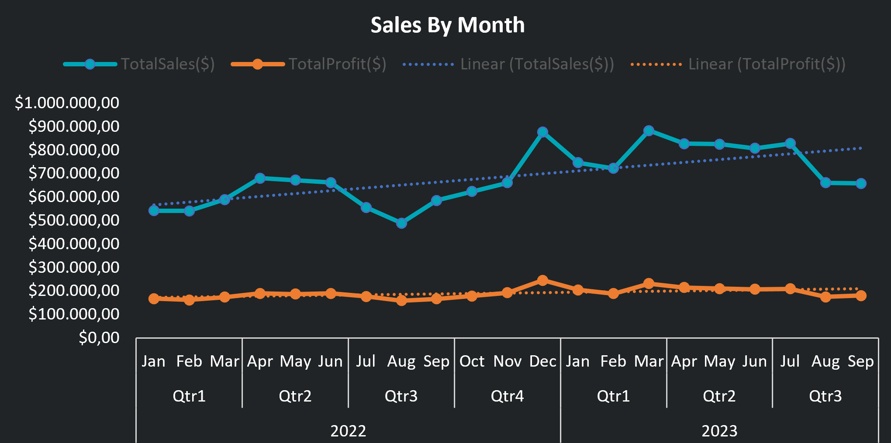
### Location Revenue Contribution Analysis
Compares each location’s revenue contribution as a percentage of the city’s total revenue to identify the highest-contributing locations.

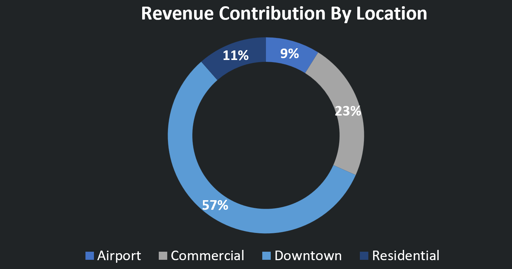

## Analysis Results and Key Findings
### Revenue and Profit Analysis of the Top 5 Cities
The Top 5 city analysis shows that the ranking order is consistent for both revenue and profit, from 1st to 5th place, although the values and percentage differences vary. The following table compares revenue, profit, and percentage differences for each city.
| **City**         | **Revenue ($)** | **Difference Revenue (%)** | **Profit ($)** | **Difference Profit(%)** |
|------------------|-----------------|:--------------------------:|----------------|:------------------------:|
| Cuidad de Mexico | $1.649.492,01   |              -             | $465.558,00    |             -            |
| Guadalajara      | $1.322.099,46   |             25%            | $368.930,00    |            26%           |
| Monterrey        | $1.261.845,70   |             5%             | $346.729,00    |            6%            |
| Hermosillo       | $903.388,84     |             40%            | $263.608,00    |            32%           |
| Guanajuato       | $869.055,83     |             4%             | $235.047,00    |            12%           |

Key findings :

The ranking of the top five cities is consistent for both revenue and profit. Cuidad de Mexico leads with revenue of $1,649,492.01 and profit of $465,558.00, followed by Guadalajara and Monterrey. However, the gap between cities varies considerably.

1. Cuidad de Mexico leads in both revenue and profit, outperforming Guadalajara by 25% in revenue and 26% in profit.
2. Guadalajara and Monterrey show relatively close performance, with Monterrey trailing Guadalajara by only 5% in revenue and 6% in profit.
3. Hermosillo and Guanajuato rank fourth and fifth, respectively, with revenue differences of only 4% between them, although their profit gap is 12%.

These findings indicate that the leading cities have stronger financial performance, but the relatively small gap between Guadalajara and Monterrey makes their historical trends important for further evaluation.
### Historical Trends
Historical trend analysis evaluates changes in revenue and profit for each city based on quarterly data. It covers changes from Q1 to Q4 2022 and compares Q1-Q3 2023 with the same period in 2022 to ensure a fair comparison.
The following table summarizes the key findings to identify changes in revenue and profit for each city.
| **City**         | **Revenue Change Q1-Q4 2022 (%)** | **Profit Change Q1-Q4 2022 (%)** | **Revenue Change Q1-Q3 2023 (%)** | **Profit Change Q1-Q3 2023 (%)** | **Revenue Change Q1-Q3 2022 VS 2023 (%)** | **Profit Change Q1-Q3 2022 VS 2023 (%)** |
|------------------|-----------------------------------|----------------------------------|-----------------------------------|----------------------------------|-------------------------------------------|------------------------------------------|
| Cuidad de Mexico |                20%                |                23%               |                -18%               |               -25%               |                    24%                    |                    13%                   |
| Guadalajara      |                27%                |                13%               |                -12%               |                -7%               |                    21%                    |                    8%                    |
| Monterrey        |                16%                |                8%                |                12%                |                10%               |                    29%                    |                    19%                   |
| Hermosillo       |                31%                |                16%               |                -2%                |                0%                |                    32%                    |                    12%                   |
| Guanajuato       |                31%                |                21%               |                -8%                |                0%                |                    34%                    |                    23%                   |

<table>
  <tr>
    <th>City</th>
    <th>Trend Historical</th>
  </tr>
  <tr>
    <td align="center">
      Cuidad de Mexico
    </td>
    <td align="center">
      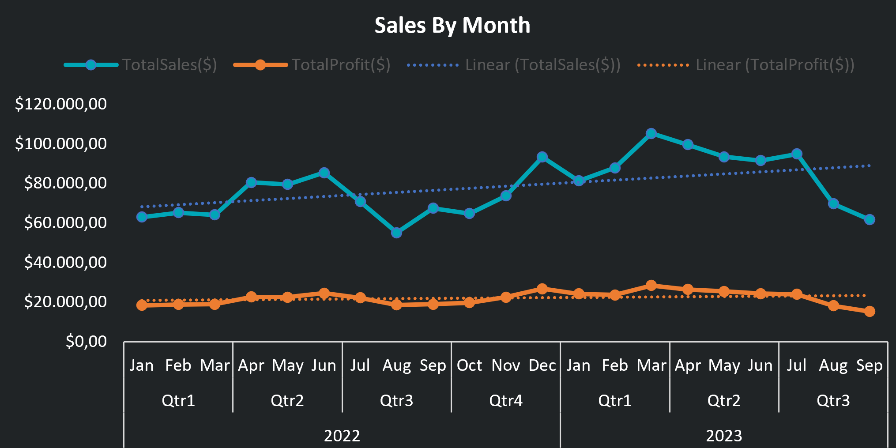
    </td>
      </tr>
    <tr>
      <td align="center">
      Guadalajara
    </td>
    <td align="center">
      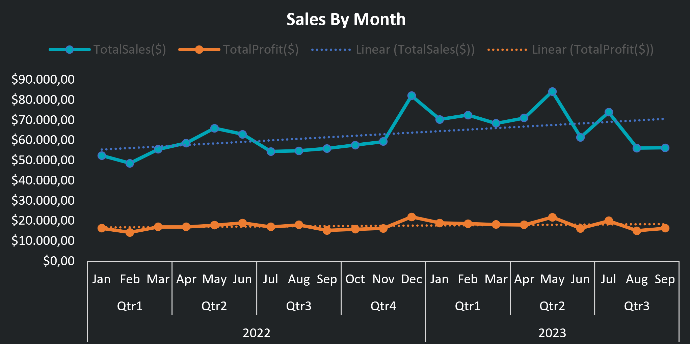
    </td>
    </tr>
    <tr>
      <td align="center">
      Monterrey
    </td>
    <td align="center">
      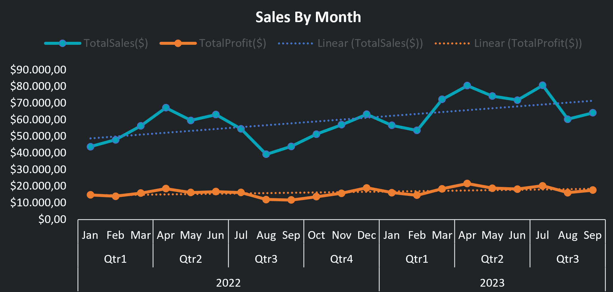
    </td>
    </tr>
    <tr>
      <td align="center">
      Hermosillo
    </td>
    <td align="center">
      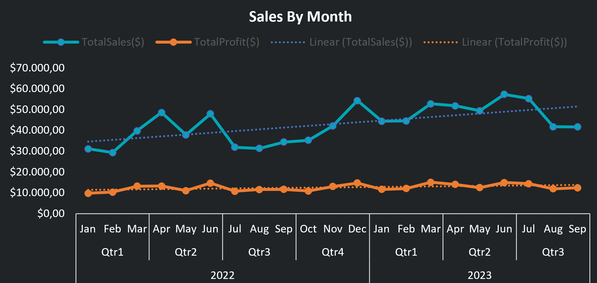
    </td>
    </tr>
    <tr>
      <td align="center">
      Guanajuato
    </td>
    <td align="center">
      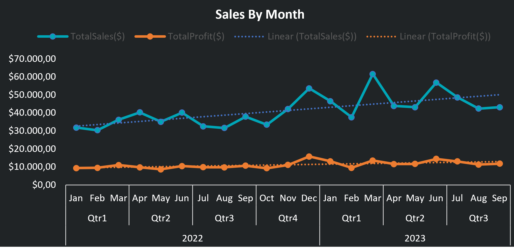
    </td>
    </tr>
</table>

Key Findings : 

The historical analysis reveals that high financial rankings do not necessarily translate into consistent performance over time.

1. Cuidad de Mexico experienced revenue growth of 20% and profit growth of 23% from Q1 to Q4 2022. However, during Q1-Q3 2023, revenue declined by 18% and profit by 25%. Despite this decline, its Q1-Q3 2023 performance remained higher than the same period in 2022, with revenue increasing by 24% and profit by 13%.
2. Guadalajara recorded growth of 27% in revenue and 13% in profit throughout Q1-Q4 2022. In Q1-Q3 2023, revenue declined by 12% and profit by 7%, although both remained above their Q1-Q3 2022 levels, increasing by 21% and 8%, respectively.
3. Monterrey showed relatively consistent performance, with revenue and profit increasing by 16% and 8% from Q1 to Q4 2022. During Q1-Q3 2023, both continued to grow by 12% and 10%. Compared with Q1-Q3 2022, revenue increased by 29% and profit by 19%.
4. Hermosillo experienced strong growth in 2022, with revenue increasing by 31% and profit by 16%. In Q1-Q3 2023, revenue declined slightly by 2%, while profit remained unchanged. Nevertheless, compared with Q1-Q3 2022, revenue increased by 32% and profit by 12%.
5. Guanajuato recorded growth of 31% in revenue and 21% in profit during 2022. In Q1-Q3 2023, revenue declined by 8%, while profit remained unchanged. Compared with the same period in 2022, revenue increased by 34% and profit by 23%.

Monterrey stands out for its positive performance across the observed periods, with continued growth during Q1-Q3 2023. Although Cuidad de Mexico leads in total revenue and profit, its recent quarterly decline warrants further attention. These findings suggest that Monterrey deserves further consideration as an expansion candidate, subject to the subsequent location-level revenue contribution analysis.
### Location Revenue Contribution
After City 3 was identified as an initial candidate based on performance comparisons and historical trends, the analysis evaluated each location’s contribution to the city’s total revenue over the same period.

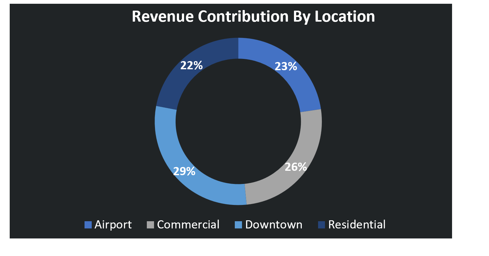

Key Findings : 

1. Airport  contributed 23% of Monterrey’s total revenue.
2. Commercial contributed 26% of Monterrey’s total revenue.
3. Downtown contributed 29% of Monterrey’s total revenue.
4. Residential contributed 22% of Monterrey’s total revenue.

Downtown contributes the largest share of Monterrey’s total revenue at 29%, making it the top priority when considering locations for new store expansion in the city.

## Recommendation
Based on the revenue and profit analysis, historical trends, and location-level revenue contributions, Monterrey is recommended as a potential city for new store expansion. Although Ciudad de México leads in total revenue and profit, Monterrey demonstrates more consistent performance, with continued growth in both metrics during Q1–Q3 2023. Within Monterrey, Downtown should be prioritized for further evaluation as a potential new store location, as it contributes the largest share of the city’s total revenue at 29%, followed by Commercial at 26%, Airport at 23%, and Residential at 22%. Therefore, Downtown is the primary location to consider for new store expansion in Monterrey, subject to further evaluation of market potential, operating costs, and site suitability.

##  Project Information
1. Tools : Microsoft Excel 2021
2. Data Preparation : Power Query
3. Data Modeling : Power Pivot
4. Calculations : DAX
5. Analysis : PivotTable
6. Visualization : PivotChart
7. Interactivity : Slicer
8. Business Focus : Sales Analysis, Profitability Analysis, Historical Trend Analysis, Location Revenue Contribution, dan Retail Expansion Strategy

nb. password sheet : dataanalis

